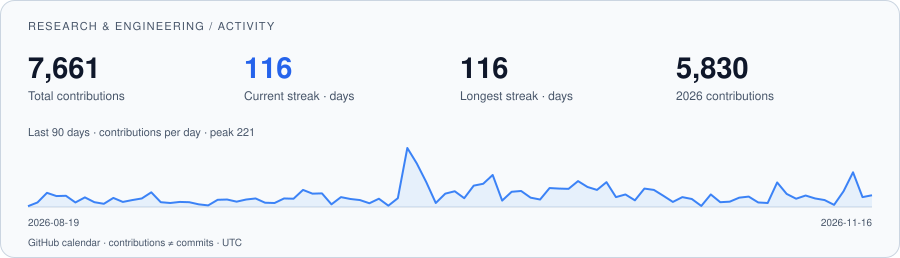
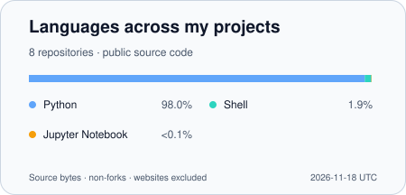

  
  
  
  
  

  <b>Foundation models - Agentic systems - World Model</b> 
  <a href="https://cngvng.github.io/publications">Publications</a> ·
  <a href="https://cngvng.github.io">Research portfolio</a> ·
  <a href="mailto:cuong.vuongtuan@phenikaa-uni.edu.vn">Open to research collaborations</a>

 

## About

I am a **Research Engineer at VNPT AI** and a **Research Assistant at the Applied AI Lab, Phenikaa University**, working with [Dr. Luong Van Thien](https://tvluong.wordpress.com/) and [Dr. Mai Xuan Trang](https://comp.phenikaa-uni.edu.vn/faculty/dr-mai-xuan-trang/).

I study how foundation and agentic models reason over **multimodal, temporal, and structured evidence**. My work connects multi-agent language systems, knowledge graphs, and patient representation learning, with healthcare as a primary application domain.

<table>
  <tr>
    <td width="55%">
      <b>Research question</b> 
      How can AI systems preserve, connect, and explain evidence when it is distributed across modalities, time, and structured sources?
    </td>
    <td width="45%">
      <b>Current direction</b> 
      PhD opportunities · Spring / Fall 2027 
      <a href="mailto:cuong.vuongtuan@phenikaa-uni.edu.vn">Let's connect →</a>
    </td>
  </tr>
</table>

## Research map

| 01 · **Agentic reasoning** | 02 · **Patient representations** | 03 · **Medical report generation** |
| :---: | :---: | :---: |
| Evidence is distributed across documents → coordinate specialized agents with structured knowledge. | Clinical evidence is heterogeneous and incomplete → preserve relations and select patient-relevant information. | Complementary imaging evidence can be lost → study evidence-preserving fusion and report generation. |
| [Explore the language systems project →](https://cngvng.github.io/projects/language-systems-multi-source-reasoning) | [Explore patient modeling →](https://cngvng.github.io/projects/structured-multimodal-healthcare#patient-modeling) | [Explore medical generation →](https://cngvng.github.io/projects/structured-multimodal-healthcare#medical-generation) |

## Selected work

<table>
  <tr>
    <td>
      <b>Multi-source reasoning</b> 
      Multi-agent language systems that retrieve, organize, and reason over distributed evidence.
    </td>
    <td>
      <b>Structured healthcare AI</b> 
      Patient-centered representations and multimodal generation for clinically meaningful outputs.
    </td>
  </tr>
  <tr>
    <td>
      <a href="https://cngvng.github.io/projects/language-systems-multi-source-reasoning">
        Read the project brief →
      </a>
    </td>
    <td>
      <a href="https://cngvng.github.io/projects/structured-multimodal-healthcare">
        Read the project brief →
      </a>
    </td>
  </tr>
</table>

## Research activity

<picture>
  <source media="(max-width: 600px) and (prefers-color-scheme: dark)" srcset="assets/activity-mobile-dark.svg" />
  <source media="(max-width: 600px)" srcset="assets/activity-mobile-light.svg" />
  <source media="(prefers-color-scheme: dark)" srcset="assets/activity-dark.svg" />
  
</picture>

  
    <a href="https://github.com/cngvng?tab=overview">Activity across projects</a>
    ·
    <a href="assets/activity.json">Calendar data &amp; commit/PR breakdown</a>
  

<b>Languages, organizations &amp; project scope</b>

 

<picture>
  <source media="(max-width: 600px) and (prefers-color-scheme: dark)" srcset="assets/languages-mobile-dark.svg" />
  <source media="(max-width: 600px)" srcset="assets/languages-mobile-light.svg" />
  <source media="(prefers-color-scheme: dark)" srcset="assets/languages-dark.svg" />
  
</picture>

**Project organizations:**

[Research](https://github.com/cngvng-research) ·
[Papers](https://github.com/cngvng-papers) ·
[Tech](https://github.com/cngvng-tech)

[Scope &amp; data](assets/languages.json) ·
[How it updates](SETUP.md)

 

  <a href="mailto:cuong.vuongtuan@phenikaa-uni.edu.vn">
    <b>Building AI that reasons across multimodal evidence →</b>
  </a>

