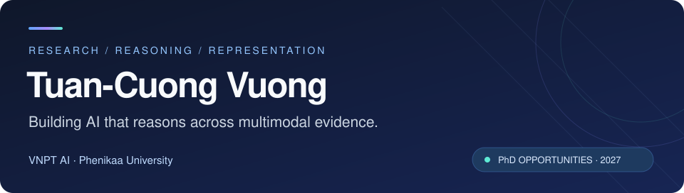
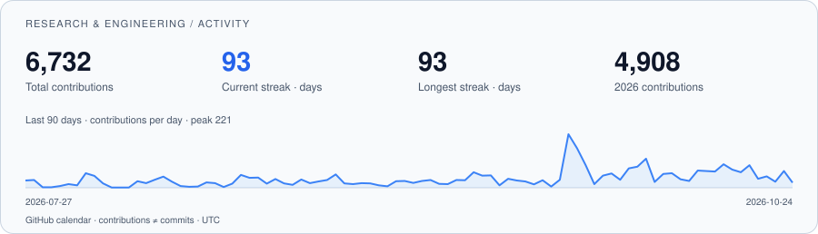
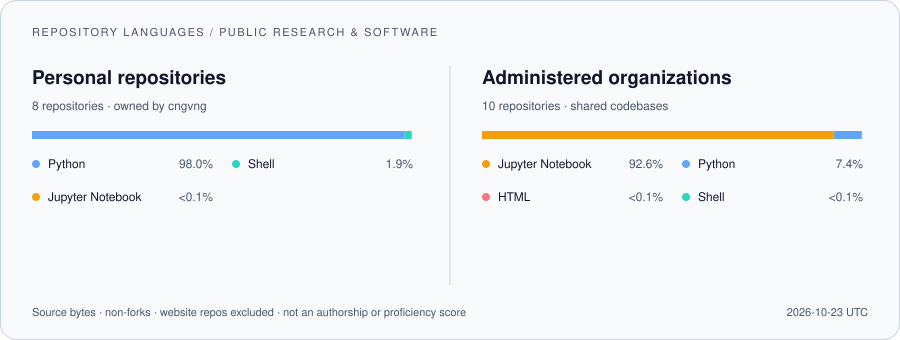

  
  
  
  
  

### About

I am a **Research Engineer at VNPT AI** and a **Research Assistant at the Applied AI Lab, Phenikaa University**, working with [Dr. Luong Van Thien](https://tvluong.wordpress.com/) and [Dr. Mai Xuan Trang](https://comp.phenikaa-uni.edu.vn/faculty/dr-mai-xuan-trang/).

I study how foundation and agentic models reason over **multimodal, temporal, and structured evidence**. My work connects multi-agent language systems, knowledge graphs, and patient representation learning, with healthcare as a primary application domain.

> **Seeking PhD opportunities · Spring / Fall 2027** 
> Foundation models · Agentic systems · Multimodal & structured reasoning · AI for healthcare 
> [Research portfolio](https://cngvng.github.io) · [Publications](https://cngvng.github.io/publications) · [Get in touch](mailto:cuong.vuongtuan@phenikaa-uni.edu.vn)

### Research directions

| Research direction | Problem → approach |
| :--- | :--- |
| **[Agentic reasoning](https://cngvng.github.io/projects/language-systems-multi-source-reasoning)** | Evidence is distributed across documents → coordinate specialized agents with structured knowledge. |
| **[Patient representations](https://cngvng.github.io/projects/structured-multimodal-healthcare#patient-modeling)** | Clinical evidence is heterogeneous and incomplete → preserve relations and select patient-relevant information. |
| **[Medical report generation](https://cngvng.github.io/projects/structured-multimodal-healthcare#medical-generation)** | Complementary imaging evidence can be lost → study evidence-preserving fusion and report generation. |

### Selected research & code

| Work & role | Method · paper · code |
| :--- | :--- |
| **MoA-MDS** Neural Computing and Applications, 2026 **First author** | Training-free coordination of extraction, knowledge-graph reasoning, and abstraction; evaluated on English and Vietnamese summarization benchmarks. [Paper](https://doi.org/10.1007/s00521-026-12249-y|

<b>Current studies · patient modeling & medical report generation</b>

My ongoing work investigates multi-component patient representations, patient-context-informed knowledge selection, cross-view MRI fusion, and multi-hypothesis 3D CT report generation. These are presented as **current studies / preprints**, separately from published and accepted work.

[Patient modeling & clinical reasoning](https://cngvng.github.io/projects/structured-multimodal-healthcare#patient-modeling) · [Medical vision–language generation](https://cngvng.github.io/projects/structured-multimodal-healthcare#medical-generation)

### From methods to working systems

I work across **problem formulation, method implementation, experimental evaluation, and research communication**. My engineering experience includes multi-agent RAG, clinical-data pipelines, and self-hosted model serving—connecting research questions to systems that can be evaluated and improved.

**Core toolkit:** Python · PyTorch · Transformers · Knowledge graphs · Retrieval & agent orchestration · SQL · LaTeX

[Experience & background](https://cngvng.github.io/experience) · [Research notes](https://cngvng.github.io/blog)

### Research & engineering activity

<picture>
  <source media="(max-width: 600px) and (prefers-color-scheme: dark)" srcset="assets/activity-mobile-dark.svg" />
  <source media="(max-width: 600px)" srcset="assets/activity-mobile-light.svg" />
  <source media="(prefers-color-scheme: dark)" srcset="assets/activity-dark.svg" />
  
</picture>

[Activity across projects](https://github.com/cngvng?tab=overview) · [Calendar data & commit/PR breakdown](assets/activity.json)

<b>Languages & my project organizations · compact overview</b>

 
<picture>
  <source media="(max-width: 600px) and (prefers-color-scheme: dark)" srcset="assets/languages-mobile-dark.svg" />
  <source media="(max-width: 600px)" srcset="assets/languages-mobile-light.svg" />
  <source media="(prefers-color-scheme: dark)" srcset="assets/languages-dark.svg" />
  
</picture>

**My project organizations:** [Research](https://github.com/cngvng-research) · [Papers](https://github.com/cngvng-papers) · [Tech](https://github.com/cngvng-tech)

[Scope & data](assets/languages.json) · [How it updates](SETUP.md)

---

Open to research collaborations on agentic reasoning, multimodal learning, and healthcare AI. 
**[Let's connect →](mailto:cuong.vuongtuan@phenikaa-uni.edu.vn)**
